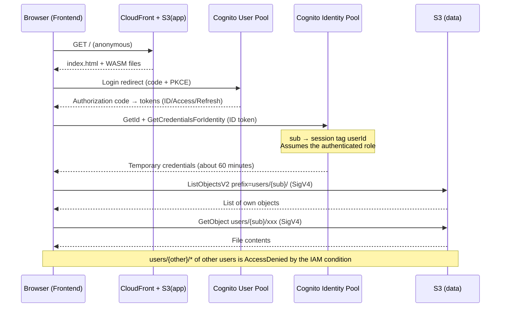

# template-aws-s3-wasm

English | [日本語](README.ja.md)

Template of a Blazor WebAssembly application that runs on AWS S3 static hosting.
It authenticates with Cognito, and users can read **only "their own data files" on S3**. An authenticated Lambda API is also included.

This document alone is enough to build, operate, and extend it from scratch.

---

## 📖 Overview

### What it does

- Sign in with Cognito Managed Login and list and view only the files under `users/{sub}/` on S3
- CSV files are rendered as summary values, a chart, and a detail table
- Call the authenticated API of API Gateway + Lambda (unauthenticated calls are blocked with 401)
- The whole infrastructure is reproducible with CDK (C#) and can be deployed and removed with a few commands

### Assumptions and trade-offs

| Item | Policy |
|---|---|
| Writing data | **Read only**. Another system is assumed to place the data on S3 (only a seed script for verification is included) |
| User registration | Self sign-up disabled. **Issued by administrators only** |
| UI | The minimum for a template. No business features |
| Region | Fixed to `ap-northeast-1` (to change it, edit `Template.IaC/EnvironmentConfig.cs` and `scripts/common.ps1`) |

### When this architecture does not fit

It works on the assumption that each user reads only their own small to medium-sized files. In the following cases, change the design to move the processing to the API layer.

- The amount of data per user grows too large to load in the browser
- Aggregation or search across multiple users is needed
- Data needs to be joined or processed on the server side

---

## 🏗️ Architecture

```mermaid
graph LR
    subgraph Browser["Browser (Blazor WASM)"]
        App[Frontend]
    end

    subgraph AWS
        CF[CloudFront<br/>OAC + security headers<br/>SPA fallback]
        AppBucket[(S3: app bucket<br/>private)]
        UP[Cognito User Pool<br/>Managed Login<br/>Authentication: OIDC code+PKCE]
        IP[Cognito Identity Pool<br/>Authorization: temporary AWS credentials<br/>+ Principal Tag]
        DataBucket[(S3: data bucket<br/>users/&#123;sub&#125;/...<br/>private + CORS)]
        APIGW[API Gateway HTTP API<br/>Cognito JWT authorizer]
        Fn[Lambda<br/>Reads validated claims]
    end

    App -- "① App delivery (anonymous)" --> CF
    CF --> AppBucket
    App -- "② Login (redirect)" --> UP
    App -- "③ ID token → temporary credentials" --> IP
    App -- "④ SigV4-signed GET/List<br/>(IAM allows only the own prefix)" --> DataBucket
    App -- "⑤ /api/* + access token (Bearer)" --> CF
    CF -- "Forwarded as the same origin" --> APIGW
    APIGW -- "Event with validated claims" --> Fn
```



④ and ⑤ are **two lanes with different authorization methods**. Both start from the same Cognito sign-in, but what evaluates the permissions differs (IAM policies for S3, and JWT validation by API Gateway for the API).

### AWS resources

| Resource | Purpose | Key points |
|---|---|---|
| S3 app bucket | Origin of the Blazor publish output | Block all public access. Readable only through CloudFront OAC |
| CloudFront | App delivery | OAC / HTTPS enforced / SPA fallback of 403 and 404 → `/index.html` (200) / security headers added / PriceClass 200 |
| S3 data bucket | Per-user data | Block all public access. CORS allows only the app origin. Accessed with SigV4-signed direct requests |
| Cognito User Pool | Authentication | Managed Login, code + PKCE, no secret, self sign-up disabled |
| Cognito Identity Pool | Authorization (issuing AWS credentials) | Authenticated identities only. Maps `sub` to a session tag with Principal Tag |
| IAM role (authenticated) | S3 data access | Limited to `users/${aws:PrincipalTag/userId}/*` |
| API Gateway (HTTP API) | Entry point of the authenticated API | JWT authorizer applied to all routes. Called as the same origin through the `/api/*` behavior of CloudFront |
| Lambda × 2 | API processing (dummy) | Managed `dotnet10` runtime |

### Key design decisions

1. **No API server for reading data** — assumes a scale where "read only + processing in the client" works, and delegates only the authorization to IAM
2. **The data bucket does not go through CloudFront** — per-user authorization is done with SigV4 signatures (= IAM evaluation). Per-user control through CloudFront would need JWT validation in Lambda@Edge, which is not worth the complexity
3. **Separate app and data buckets** — their requirements for access policy, CORS, caching, and lifecycle differ. A single bucket split by prefixes is error-prone
4. **The app itself (the WASM bundle) is not secret** — it can be delivered anonymously (the same as a typical SPA). Only the data is protected
5. **AWS CDK (C#) for IaC** — the whole repository can be in C#, and typing protects against missing settings. Terraform would also work, but the template would feel less unified as a .NET template
6. **API routing is on the CDK side** — using `[HttpApi]` of Lambda Annotations or SAM would split the infrastructure definitions into two places

---

## 🔐 Authentication and authorization

### Authentication (Cognito User Pool)

- **Flow**: Authorization Code + PKCE. Public client (no secret)
- **UI**: Redirects to Cognito Managed Login. No custom login screen
- **Authority**: `https://cognito-idp.{region}.amazonaws.com/{userPoolId}` (supports OIDC discovery)
- **Callback**: `authentication/login-callback` (the default path of `RemoteAuthenticatorView`)
- **Token lifetime**: ID / access 60 minutes, refresh 30 days (Cognito defaults)
- **Logout**: Own implementation (for the reason, see [Implementation pitfalls](#%EF%B8%8F-implementation-pitfalls))

### S3 authorization (Identity Pool + IAM)

It **uses Principal Tags (attribute-based access control)**.

| Method | Decision |
|---|---|
| **Principal Tag** — maps `sub` of the ID token to the session tag `userId` and uses `${aws:PrincipalTag/userId}` in IAM | **Adopted**. Because the S3 keys can be partitioned by the sub of the User Pool, the side that places the data only needs to know the sub |
| IdentityId variable — the classic pattern that partitions the prefixes with `${cognito-identity.amazonaws.com:sub}` | Not adopted. The IdentityId is not fixed until the first login and changes when the Identity Pool is recreated. It cannot be matched with the side that places the data |

- The Identity Pool allows only authenticated identities (guest access disabled)
- The trust policy of the authenticated role needs **`sts:TagSession`** in addition to `sts:AssumeRoleWithWebIdentity` (a prerequisite for propagating session tags)

**Data layout**

```
s3://{data-bucket}/
  users/
    {userPoolSub}/          ← sub of the User Pool (UUID)
      profile.json
      reports/2026-07.csv
```

**IAM policy of the authenticated role**

```json
{
  "Version": "2012-10-17",
  "Statement": [
    {
      "Sid": "ListOwnPrefix",
      "Effect": "Allow",
      "Action": "s3:ListBucket",
      "Resource": "arn:aws:s3:::{data-bucket}",
      "Condition": {
        "StringLike": { "s3:prefix": ["users/${aws:PrincipalTag/userId}/*"] }
      }
    },
    {
      "Sid": "GetOwnObjects",
      "Effect": "Allow",
      "Action": "s3:GetObject",
      "Resource": "arn:aws:s3:::{data-bucket}/users/${aws:PrincipalTag/userId}/*"
    }
  ]
}
```

### API authorization (API Gateway JWT authorizer)

Unlike S3, the API uses **token-based** authorization. The client sends `Authorization: Bearer {access token}`, and API Gateway validates the signature, issuer, and audience.

The app calls the API **through `/api/*` of CloudFront**, not directly. Because it is the same origin, no CORS preflight occurs, and `'self'` is enough for CSP. CloudFront is configured with caching disabled and forwarding of the `Authorization` header (only the Host header is not forwarded, because API Gateway routes by its own domain).

- **The authorizer is applied to all routes**, to leave no room for forgetting it on a route
- **No authorization logic in Lambda**. The premise that a request is already validated when it arrives is important, and checking twice would blur that premise
- Lambda reads the claims from `RequestContext.Authorizer.Jwt.Claims` of the event. Because they are **not values declared by the client**, the processing can be limited per user with `sub`

**Why Lambda is not invoked directly**: Calling Lambda directly with the temporary credentials of the Identity Pool (the same IAM authorization as S3) needs the least additional infrastructure, but **Lambda cannot verify the calling user** (the sub in the payload is declared by the client). It cannot be developed into per-user server processing.

**Note on token types**: API Gateway matches the audience with `aud` **or** `client_id`, so **validation passes even if an ID token is sent** (confirmed by measurement). To reject by type, check the `token_use` claim in Lambda.

### Sequence



---

## 🔧 Creating a new project from the template

To use this repository as a template, first replace the names. There are three kinds of names to replace.

| Kind | Current value | Used in |
|---|---|---|
| Project name (PascalCase) | `Template` | Namespaces, project names, directory names, **assembly names** |
| Deploy name (kebab-case) | `template-aws-s3-wasm` | CloudFormation stack name |
| Cognito domain prefix | `template-s3-wasm` | URL of Managed Login |

The deploy name and the Cognito domain prefix are different values because the latter cannot contain the reserved word `aws`. The domain prefix must be **unique across all AWS accounts**.

### Steps

Run at the repository root. Change only the first three lines to your own values.

```powershell
$Name   = 'Acme'          # PascalCase. Becomes the namespaces and assembly names
$Deploy = 'acme-portal'   # kebab-case. Becomes the CloudFormation stack name
$Domain = 'acme-portal'   # Cognito domain prefix. Cannot contain aws/amazon/cognito

# 1. Replace the file contents (excluding .git and the output directories)
Get-ChildItem -Recurse -File |
    Where-Object { $_.FullName -notmatch '\\(\.git|bin|obj|publish-api|publish-app|cdk\.out|node_modules)\\' } |
    ForEach-Object {
        $body = Get-Content $_.FullName -Raw
        $new = $body.Replace('Template.', "$Name.").Replace('template-aws-s3-wasm', $Deploy).Replace('template-s3-wasm', $Domain)
        if ($new -ne $body) { Set-Content $_.FullName $new -NoNewline }
    }

# 2. Rename the project files and directories
foreach ($p in 'Backend', 'Frontend', 'IaC') {
    Rename-Item "Template.$p/Template.$p.csproj" "$Name.$p.csproj"
    Rename-Item "Template.$p" "$Name.$p"
}
Get-ChildItem -Filter 'Template.sln*' | ForEach-Object { Rename-Item $_.FullName ($_.Name -replace '^Template', $Name) }

# 3. Verify
dotnet build
```

> ⚠️ Always replace **`Template.` with the dot**. Replacing `Template` alone also hits descriptions of the template in the text and unrelated identifiers.

After the replacement, this section is no longer needed and can be removed from the README.

Note that the following two are **text displayed on screen, not identifiers**, so the replacement above does not change them. Rewrite them by hand to fit your project.

| File | Text |
|---|---|
| `{Name}.Frontend/Components/Layout/MainLayout.razor` | `S3 + Cognito WASM Template` in the header |
| `{Name}.Frontend/Components/Pages/Home.razor` | `Template application that ...` in the description |

### The most error-prone place for missed replacements

Even if the Lambda handler names in `{Name}.IaC/ApiConstruct.cs` are wrong, **the deployment still succeeds**.

```csharp
Handler = $"Template.Backend::Template.Backend.Functions.{functionClass}_Handle_Generated::Handle",
```

CloudFormation does not validate this string, so if the assembly name is wrong, `cdk deploy` finishes normally and **only the API calls fail with 500 at run time** (`Could not find the specified handler assembly`). Replacing as in the steps above fixes it, but suspect this place first if you renamed by hand.

Similarly, if the following two do not match, the deployment succeeds but the scripts stop working.

- The stack ID in `{Name}.IaC/Program.cs` and `$stack` in `scripts/common.ps1` — if they differ, the cdk outputs cannot be read
- `domainPrefix` in `{Name}.IaC/cdk.json` — a name in use by another account fails with `InvalidRequest`

### Checking after renaming

Continue with the [setup](#-setup-initial-build) below. Always check that **the two calls on the "API" page return 200**. A missed replacement of a handler name shows up only here.

---

## 🚀 Setup (initial build)

### Requirements

- .NET SDK 10.0+
- Node.js 20+ (to run the CDK CLI)
- AWS CLI v2 (with credentials configured)

### Preparation

Change `context.dev.domainPrefix` in `Template.IaC/cdk.json` to a **unique value**. It becomes the domain name of Cognito Managed Login, so it must be unique across all AWS accounts.

> ⚠️ Only lowercase letters, digits, and hyphens. It **cannot contain** the reserved words `aws` / `amazon` / `cognito` (if it does, the deployment fails with `InvalidRequest`). Using the repository name as is may hit this.

### Build steps

```powershell
# 1. Prepare the Lambda artifact (CDK takes it in as an asset)
./scripts/deploy-api.ps1

# 2. Deploy the infrastructure
cd Template.IaC
npx --yes aws-cdk@latest bootstrap        # Only the first time per account × region
npx --yes aws-cdk@latest deploy -c env=dev --outputs-file ../cdk-outputs.dev.json
cd ..

# 3. Apply the outputs to the settings for local development
./scripts/update-appsettings.ps1 -Env dev

# 4. Add a test user + sample data
./scripts/seed-user.ps1 -Env dev -Email user1@example.com

# 5. Build and deliver the app
./scripts/deploy-app.ps1 -Env dev
```

Open the URL displayed at the end, and log in with the Email / Password output by `seed-user.ps1`.

### What to check

- Accessing `/files` without logging in → redirected to the login
- After logging in, the list of your own data files, the summary values, the chart, and the detail table are displayed
- "open raw" (a direct S3 link) in the list returns `AccessDenied` when opened in the browser, **even while logged in**
- Create two users, and getting an object with another user's key returns AccessDenied
- The two calls on the "API" page succeed, and the returned `sub` is your own
- Calling `/hello` repeatedly increases `invocation` (the same execution environment is reused)
- **Calling the API without a token returns 401, and Lambda does not start**
  (`curl https://{ApiEndpoint}/hello` → 401. No new invocation records appear in CloudWatch Logs)
- Direct access to deep links and reloading work (SPA fallback)

---

## 🔄 Deploying updates

What to run depends on what you changed.

| Changed | What to run |
|---|---|
| **Template.Frontend only** | `./scripts/deploy-app.ps1 -Env dev` |
| **Template.Backend (Lambda)** | `./scripts/deploy-api.ps1` → `cd Template.IaC; npx --yes aws-cdk@latest deploy -c env=dev --outputs-file ../cdk-outputs.dev.json` |
| **Template.IaC** | Same as above (`deploy-api.ps1` is not needed if Template.Backend is unchanged) |
| **Template.IaC, and the output values changed** | After the above, `./scripts/update-appsettings.ps1 -Env dev` and `deploy-app.ps1` |

`deploy-app.ps1` generates `appsettings.Production.json` from the cdk outputs before publishing (because the delivered WASM app always runs as the Production environment). The generated file is gitignored.

### prod environment

Deploy with `-c env=prod`. The differences from dev are as follows.

- The buckets and the User Pool are **RETAIN + deletion protection** (data is not lost by accidental deletion)
- The localhost callback URL / CORS permission is **not added**
- The log retention period is 1 month

---

## 🌏 Changing the deployment target

The places to change when changing the region, account, or stack name. **The region and the stack name are scattered in the code as constants, so fix every place in the tables below** (if even one is missed, the deployment succeeds but fails at run time).

### Changing the region

| File | Place |
|---|---|
| `Template.IaC/EnvironmentConfig.cs` | `Region` constant |
| `scripts/common.ps1` | `$Script:Region` |
| `Template.Frontend/wwwroot/index.html` | The two `preconnect` lines (the Cognito host names contain the region) |
| `Template.Frontend/wwwroot/appsettings.json` | The region in the placeholders (the actual values are generated at deployment, so this is only for consistency) |

The regions in CSP and CORS are built from `EnvironmentConfig.Region`, so no additional changes are needed.

Then run `npx --yes aws-cdk@latest bootstrap` in the new region before deploying.

### Changing the AWS account

1. Switch the credentials of the AWS CLI (`$env:AWS_PROFILE` when using a profile)
2. Run `bootstrap` for the new account × region
3. Change `domainPrefix` in `Template.IaC/cdk.json` (**Cognito domains are unique across all AWS accounts**, so a name in use by another account cannot be taken)

### Changing the stack name

| File | Place |
|---|---|
| `Template.IaC/Program.cs` | Stack ID (`template-aws-s3-wasm-{envName}`) |
| `scripts/common.ps1` | How `$stack` is built (the JSON of the cdk outputs is looked up by this name) |

If the two do not match, the deployment succeeds, but the scripts cannot read the outputs.

### Changing the local development port

Change **both** `Template.Frontend/Properties/launchSettings.json` and `LocalhostOrigin` in `Template.IaC/EnvironmentConfig.cs`. The latter becomes the Cognito callback URL of dev and the allowed CORS origin of S3, so if they differ, logging in and getting data from local fail.

### Adding environments (dev / prod)

Add a new key to `context` in `Template.IaC/cdk.json`, and define `domainPrefix` and `allowLocalhost`. `-Env` of the scripts is limited to `dev` / `prod`, so when adding environments, also update `ValidateSet` of each script.

---

## 🧹 Removal (cleanup)

```powershell
cd Template.IaC
npx --yes aws-cdk@latest destroy -c env=dev
```

In the **dev environment**, with the automatic deletion of the buckets (`autoDeleteObjects`) and of the LogGroups, the resources managed by the stack are removed without leftovers. However, only the LogGroup `/aws/lambda/{stack name}-CustomS3AutoDeleteObjects-*` remains. It is created implicitly when the Lambda built into CDK that empties the buckets first runs, and it is not removed because it is outside CloudFormation management. It is empty and costs nothing, but remove it manually if you prefer.

In the **prod environment**, the buckets and the User Pool are RETAIN + deletion protection, so they must be removed manually after deleting the stack. This is an intentional design that prioritizes protecting the data. The LogGroup of the API is also RETAIN, so it remains.

```powershell
# Check for leftovers (after deleting the stack)
aws s3api list-buckets --query "Buckets[?contains(Name,'template-aws-s3-wasm')].Name"
aws cognito-idp list-user-pools --max-results 60 --query "UserPools[?contains(Name,'template')].[Id,Name]"
aws logs describe-log-groups --query "logGroups[?contains(logGroupName,'template-aws-s3-wasm')].logGroupName"
```

---

## 📁 Program structure

```
template-aws-s3-wasm/
├── .editorconfig / Analyzers.ruleset / Directory.Build.props / Directory.Build.targets
├── AGENTS.md                                ← Coding conventions
├── Template.slnx                            ← Solution (3 projects)
│
├── Template.Backend/                                 ← Lambda (net10.0, managed dotnet10 runtime)
│   ├── Startup.cs                           ← [LambdaStartup]. Registration to the DI container
│   ├── Functions/
│   │   ├── HelloFunction.cs                 ← GET /hello. Returns the validated claims
│   │   └── EchoFunction.cs                  ← POST /echo. Receives a JSON body
│   ├── Services/InvocationCounter.cs        ← Singleton that survives across warm starts
│   ├── Application/                         ← Claims (extracting claims) / Json (creating responses)
│   ├── Models/                              ← HelloResponse / EchoModels
│   ├── FunctionSerializerContext.cs         ← Shared by all functions (LambdaSerializer is per assembly)
│   ├── Assembly.cs                          ← CLSCompliant + LambdaSerializer attributes
│   └── GlobalUsing.cs / GlobalSuppressions.cs
│
├── Template.Frontend/                                ← Blazor WebAssembly (net10.0)
│   ├── Program.cs                           ← DI configuration
│   ├── Assembly.cs / GlobalUsing.cs / GlobalSuppressions.cs / Log.cs
│   ├── Application/
│   │   ├── BrowserHttpClientFactory.cs      ← Replaces the HTTP handling to run the AWS SDK on browser-wasm
│   │   ├── SeriesParser.cs                  ← Parses CSV → DataSeries
│   │   └── ViewHelper.cs                    ← View helper (used from markup with @using static)
│   ├── Auth/
│   │   ├── OidcTokenAccessor.cs             ← Reads the ID token from sessionStorage
│   │   ├── AwsCredentialsProvider.cs        ← Gets and caches temporary credentials from the ID token
│   │   └── SignOutService.cs                ← Own sign-out to /logout of Cognito
│   ├── Components/
│   │   ├── App.razor / _Imports.razor / RedirectToLogin.cs
│   │   ├── Chart/SeriesChart.razor(.cs)     ← Inline SVG chart
│   │   ├── Layout/MainLayout.razor(.cs)     ← Login state + login/logout
│   │   └── Pages/
│   │       ├── Home.razor                   ← Authentication state and claims
│   │       ├── Files.razor(.cs)             ← [Authorize] List, summary, chart, details, direct links
│   │       ├── Api.razor(.cs)               ← [Authorize] Calls the authenticated API and shows the results
│   │       ├── Authentication.razor(.cs)    ← RemoteAuthenticatorView ({action})
│   │       └── NotFound.razor
│   ├── Helpers/MediaHelper.cs               ← Decides whether a media type can be rendered
│   ├── Models/                              ← UserFile / SeriesPoint / DataSeries / HelloResponse
│   ├── Services/
│   │   ├── UserFileRepository.cs            ← List / Get of the own prefix, and creating direct links
│   │   └── ApiClient.cs                     ← Calls the authenticated API
│   ├── Settings/AppSetting.cs               ← App section of appsettings.json
│   └── wwwroot/                             ← index.html (with a splash) / appsettings*.json / css
│
├── Template.IaC/                                     ← AWS CDK (C#). Flat structure to avoid namespace collisions with the Constructs package
│   ├── cdk.json                             ← Context per environment (domainPrefix / allowLocalhost)
│   ├── Program.cs                           ← App entry (-c env=dev|prod)
│   ├── EnvironmentConfig.cs                 ← Reads the context, and constants such as the region
│   ├── Infrastructure.cs                    ← Stack body (named without the 'Stack' suffix because of CA1711)
│   ├── HostingConstruct.cs                  ← App bucket + CloudFront
│   ├── AuthConstruct.cs                     ← User Pool + Client + Domain + Identity Pool + roles
│   ├── DataConstruct.cs                     ← Data bucket + CORS
│   └── ApiConstruct.cs                      ← Lambda + HTTP API + JWT authorizer
│
├── scripts/                                 ← See "Scripts" below
└── README.md                                ← This document
```

### Key components

**Template.Frontend / Program.cs**

- Replace `AWSConfigs.HttpClientFactory` **before any other AWS call**
- The settings of `AddOidcAuthentication` come from appsettings. Only the `email` scope is added in code (writing it in the settings file duplicates the default scopes)
- No data is loaded at startup (there are no credentials before authentication, so data is fetched when a page is displayed)

**Template.Frontend / AwsCredentialsProvider**

- After ensuring that the session is valid with `IAccessTokenProvider.RequestAccessToken()`, gets the ID token through `OidcTokenAccessor`
- `GetId` → `GetCredentialsForIdentity` with an anonymous client. The IdentityId is cached in the session to skip `GetId` on each page load
- Credentials are reused until 5 minutes before they expire. If they cannot be obtained, it returns `null` instead of throwing, and the caller leads the user to log in again

**Template.Frontend / UserFileRepository**

- `ListAsync(sub)` gets all items with continuation tokens. `ObjectUrl(key)` is the direct link shown on screen (URL-escaped per segment)
- `AmazonS3Client` is reused until the credentials are renewed
- The sub is taken from the claims and used to build the keys, but **the security boundary is on the IAM side**. Even if the client tampers with the keys, it cannot reach other users' data

**Build order of Template.IaC**

The build order is determined by the chain of references: **Api (body only) → Hosting → Data → Auth → Api (adding routes)**. This is because the `/api/*` origin of CloudFront needs the host name of the API, the callback URL of the App Client and the CORS of the data bucket need the CloudFront domain, and the JWT authorizer needs the App Client. `ApiConstruct` is built in two steps, "create only the body first, and add the routes and the authorizer later with `AddRoutes`", to keep this chain from becoming circular (`AWS::ApiGatewayV2::Api` itself depends on nothing). The Identity Pool is built with L1 (`Cfn*`) so that the authorization mechanism is visible.

### Settings file (wwwroot/appsettings.json)

```json
{
  "Oidc": {
    "Authority": "https://cognito-idp.ap-northeast-1.amazonaws.com/{userPoolId}",
    "ClientId": "{userPoolClientId}",
    "ResponseType": "code"
  },
  "App": {
    "Region": "ap-northeast-1",
    "UserPoolId": "ap-northeast-1_XXXXXXXX",
    "IdentityPoolId": "ap-northeast-1:xxxxxxxx-...",
    "CognitoDomain": "https://{prefix}.auth.ap-northeast-1.amazoncognito.com",
    "DataBucket": "{data-bucket-name}",
    "ApiEndpoint": "https://{distribution}.cloudfront.net/api"
  }
}
```

> **All the values here can be public**. It is a public client, and IAM and API Gateway ensure the authorization. Guessing the bucket names is also defended against by the public access block.

---

## 📜 Scripts

All are PowerShell. Run them from the repository root.

| Script | Purpose | Main arguments |
|---|---|---|
| `deploy-api.ps1` | Publishes Template.Backend to `publish-api/`. CDK takes it in as an asset, so run it **before `cdk deploy`** | None |
| `update-appsettings.ps1` | Generates `appsettings.Development.json` from the cdk outputs (for local development) | `-Env dev\|prod` |
| `seed-user.ps1` | Creates a test user and places sample data in `users/{sub}/`. Issuing real users follows the same steps | `-Email` (required) / `-Env` / `-Password` |
| `deploy-app.ps1` | Publishes Template.Frontend, syncs it to S3, and invalidates CloudFront. Also generates `appsettings.Production.json` | `-Env dev\|prod` |
| `common.ps1` | Shared processing dot-sourced by the above (reading the cdk outputs, generating appsettings). **Do not run it directly** | — |

All of them read `cdk-outputs.{env}.json` from the repository root. They do not work if `--outputs-file` is forgotten in `cdk deploy`.

---

## 🧰 Manual procedures

These are the commands that the scripts above run. Refer to them when integrating into CI, working on another machine, or redoing only the part where a script failed.

### Common: getting the stack outputs

All the following steps use the output values of the stack. If you do not use `--outputs-file`, they can be read directly from CloudFormation.

```powershell
$EnvName = 'dev'
$Stack   = "template-aws-s3-wasm-$EnvName"
$o = @{}
(aws cloudformation describe-stacks --stack-name $Stack --query 'Stacks[0].Outputs' | ConvertFrom-Json) |
    ForEach-Object { $o[$_.OutputKey] = $_.OutputValue }
$o
```

Available keys: `CloudFrontDomain` / `DistributionId` / `AppBucketName` / `DataBucketName` / `UserPoolId` / `UserPoolClientId` / `CognitoDomain` / `IdentityPoolId` / `ApiEndpoint`

### 1. Building the environment

```powershell
# (1) Prepare the Lambda artifact in publish-api/
#     The output must be directly under the repository root (ApiConstruct refers to {cwd}/../publish-api)
dotnet publish Template.Backend/Template.Backend.csproj -c Release -o publish-api

# (2) Deploy
cd Template.IaC
npx --yes aws-cdk@latest bootstrap     # Only the first time per account × region
npx --yes aws-cdk@latest deploy -c env=dev
cd ..
```

Next, create the settings file that the app reads from the output values. **The delivered app always runs as the Production environment**, so create `Template.Frontend/wwwroot/appsettings.Production.json` (for local development, `appsettings.Development.json` in the same form).

```json
{
  "Oidc": {
    "Authority": "https://cognito-idp.ap-northeast-1.amazonaws.com/{UserPoolId}",
    "ClientId": "{UserPoolClientId}",
    "ResponseType": "code"
  },
  "App": {
    "Region": "ap-northeast-1",
    "UserPoolId": "{UserPoolId}",
    "IdentityPoolId": "{IdentityPoolId}",
    "CognitoDomain": "{CognitoDomain}",
    "DataBucket": "{DataBucketName}",
    "ApiEndpoint": "{ApiEndpoint}"
  }
}
```

### 2. Deploying application updates

```powershell
# (1) Update the appsettings.Production.json above with the latest output values

# (2) Publish. Delete the output directory every time
#     dotnet publish -o does not clean it, so old fingerprinted assets stay and keep being uploaded
Remove-Item -Recurse -Force publish -ErrorAction SilentlyContinue
dotnet publish Template.Frontend/Template.Frontend.csproj -c Release -o publish

# (3) Sync to S3. First upload everything with no-cache
#     .br / .gz are excluded because the S3 origin does no content negotiation
#     (what is actually delivered is the dynamic compression of CloudFront)
aws s3 sync publish/wwwroot "s3://$($o.AppBucketName)" --delete `
    --exclude '*.br' --exclude '*.gz' --exclude 'appsettings.Development.json' `
    --cache-control 'no-cache'

# Excluded files are not covered by --delete, so explicitly delete those of past deployments
aws s3 rm "s3://$($o.AppBucketName)" --recursive `
    --exclude '*' --include '*.br' --include '*.gz' --include 'appsettings.Development.json'

# (4) Promote only the fingerprinted assets under _framework/ to long-term caching, and fix the Content-Type at the same time
#     (if .wasm is guessed as application/octet-stream, CloudFront does not compress it)
$immutable = 'public, max-age=31536000, immutable'
aws s3 cp "s3://$($o.AppBucketName)/_framework/" "s3://$($o.AppBucketName)/_framework/" --recursive `
    --exclude '*' --include '*.wasm' `
    --content-type 'application/wasm' --cache-control $immutable --metadata-directive REPLACE
aws s3 cp "s3://$($o.AppBucketName)/_framework/" "s3://$($o.AppBucketName)/_framework/" --recursive `
    --exclude '*' --include '*.js' --exclude 'dotnet.js' --exclude 'blazor.webassembly.js' `
    --content-type 'text/javascript' --cache-control $immutable --metadata-directive REPLACE

# (5) CloudFront does not compress files over 10MB. For those assets (the AOT native runtime is about 19MB),
#     overwrite the same key with the contents of the .br generated by publish
Get-ChildItem publish/wwwroot/_framework -File |
    Where-Object { $_.Length -gt 9MB -and $_.Extension -in '.wasm', '.js' } |
    ForEach-Object {
        $type = if ($_.Extension -eq '.wasm') { 'application/wasm' } else { 'text/javascript' }
        aws s3 cp "$($_.FullName).br" "s3://$($o.AppBucketName)/_framework/$($_.Name)" `
            --content-encoding br --content-type $type --cache-control $immutable
    }

# (6) Invalidate the cache ('/*' counts as one path, so it is within the free tier)
aws cloudfront create-invalidation --distribution-id $o.DistributionId --paths '/*'
```

If you changed `Template.Backend`, redo **(1)(2) of 1. Building the environment** before the above (the Lambda code is delivered as a CDK asset, so it is not applied without `cdk deploy`).

### 3. Adding users

Self sign-up is disabled, so real users are also issued with these steps.

```powershell
$Email    = 'user1@example.com'
$Password = '<a value that meets the password policy of the User Pool>'

# (1) Create the user. Set the password directly without sending an invitation email
aws cognito-idp admin-create-user --user-pool-id $o.UserPoolId --username $Email `
    --user-attributes "Name=email,Value=$Email" "Name=email_verified,Value=true" `
    --message-action SUPPRESS

# (2) Set the password permanently (clears the FORCE_CHANGE_PASSWORD state)
aws cognito-idp admin-set-user-password --user-pool-id $o.UserPoolId --username $Email `
    --password $Password --permanent

# (3) Get the sub. The S3 prefix and the IAM PrincipalTag use this value as the key
$sub = ((aws cognito-idp admin-get-user --user-pool-id $o.UserPoolId --username $Email |
    ConvertFrom-Json).UserAttributes | Where-Object Name -eq 'sub').Value

# (4) Place the data
aws s3 cp .\localdata\ "s3://$($o.DataBucketName)/users/$sub/" --recursive
```

> ⚠️ **Always quote** `Name=...,Value=...` of `--user-attributes`. Otherwise PowerShell splits them at the comma, resulting in `Invalid parameter`.

> ⚠️ The prefix must be `users/{sub}/`. Anything other than the sub, such as the email, does not match `${aws:PrincipalTag/userId}` in the IAM condition, and even the user themself gets `AccessDenied`.

**To delete a user**, delete from both Cognito and S3 (they are independent of the stack, so leaving only one of them creates orphaned data).

```powershell
aws cognito-idp admin-delete-user --user-pool-id $o.UserPoolId --username $Email
aws s3 rm "s3://$($o.DataBucketName)/users/$sub/" --recursive
```

### 4. Clearing the environment

```powershell
cd Template.IaC
npx --yes aws-cdk@latest destroy -c env=dev
cd ..
```

> ⚠️ `destroy` also runs synth internally, so **it fails with `Cannot find asset at ...\publish-api` if `publish-api/` does not exist** (a counterintuitive behavior that needs the Lambda artifact even though you only want to delete). If you deleted it, redo `dotnet publish Template.Backend/Template.Backend.csproj -c Release -o publish-api` before running it.

**prod is RETAIN + deletion protection**, so manual work is needed before and after deleting the stack.

```powershell
# (1) Remove the deletion protection of the User Pool
aws cognito-idp update-user-pool --user-pool-id $o.UserPoolId --deletion-protection INACTIVE

# (2) Delete the stack (the buckets and the User Pool set to RETAIN remain)
cd Template.IaC; npx --yes aws-cdk@latest destroy -c env=prod; cd ..

# (3) Empty the remaining buckets and then delete them (they cannot be deleted while they have contents)
foreach ($b in $o.AppBucketName, $o.DataBucketName) {
    aws s3 rm "s3://$b" --recursive
    aws s3api delete-bucket --bucket $b
}

# (4) The remaining User Pool and domain
aws cognito-idp delete-user-pool-domain --user-pool-id $o.UserPoolId --domain '<domainPrefix>'
aws cognito-idp delete-user-pool --user-pool-id $o.UserPoolId

# (5) The remaining LogGroups (those set to RETAIN, and those created implicitly by the Lambda built into CDK)
aws logs describe-log-groups --query "logGroups[?contains(logGroupName,'template-aws-s3-wasm')].logGroupName" --output text |
    ForEach-Object { $_ -split '\s+' } | Where-Object { $_ } |
    ForEach-Object { aws logs delete-log-group --log-group-name $_ }
```

For the commands to check for leftovers after the deletion, see [🧹 Removal (cleanup)](#-removal-cleanup).

---

## 💻 Local development

### Template.Frontend

```powershell
dotnet run --project Template.Frontend
```

At `http://localhost:5250`, it **connects to the real Cognito / S3 of the dev stack** (no emulator). The localhost callback URL and CORS permission are set only in the dev environment.

### Template.Backend (Lambda)

```bash
dotnet-lambda-test-tool-10.0 --path Template.Backend
```

A web UI starts, and you can debug with breakpoints by giving event JSON.

> ⚠️ Only the Lambda runtime is reproduced, and **the JWT authorizer of API Gateway is not**. Locally, the claims are the values written in the test event, so per-user processing can be checked with any `sub`, but **blocking with 401 itself cannot be checked locally**. Check the authentication blocking with curl against the real environment.

---

## 🧩 Extending

### Adding a Template.Backend (Lambda) function

1. Add a class with `[LambdaFunction]` to `Template.Backend/Functions/`
2. Add the new Request / Response types to `FunctionSerializerContext` (because the `LambdaSerializer` attribute is per assembly)
3. Add one `AddRoute` line to `Template.IaC/ApiConstruct.cs`

The source generator determines the handler name: `{Assembly}::{Namespace}.{Class}_{Method}_Generated::{Method}`

All functions share one publish output. So as the functions increase, the cold start of each function also carries the code of the other functions. With a few functions it is negligible, but as the scale grows, consider splitting the project + moving the shared processing into a Core library.

### Placing data

Place data in `s3://{DataBucket}/users/{sub}/...` from any system. `sub` is the user ID of the User Pool, and it can be obtained with `aws cognito-idp admin-get-user`.

A CSV with the `date,value,note` header is rendered as a chart + summary + detail table. Other text is displayed as raw content (decided in `Template.Frontend/Application/SeriesParser.cs`).

> ⚠️ Calling `AdminGetUser` counts the user as an MAU and makes it billable. For listing, use `ListUsers`.

### Issuing users

Self sign-up is disabled. Administrators issue users with `aws cognito-idp admin-create-user` (the same steps as `scripts/seed-user.ps1`). For the commands, see [🧰 Manual procedures - 3. Adding users](#-manual-procedures).

### Other extension points

| Item | Summary |
|---|---|
| Upload support | Add `s3:PutObject` for the own prefix to IAM, and allow PUT in the CORS of the data bucket |
| Custom domain | Put CloudFront + ACM and the Cognito custom domain on the same site (`app.example.com` / `auth.example.com`). This also solves the third-party cookie problem of silent token renewal |
| CI/CD | GitHub Actions + OIDC role. `dotnet build` + `cdk synth` on PRs, and deployment on push to main |
| Cognito | MFA, threat protection (Plus plan), issuing users with invitation emails |
| Auditing | S3 server access logs / CloudTrail data events |

---

## ⚡ Performance design

The first display consists of three waits: "download → runtime boot → resolving the authentication state".

> 📌 Note on measurement: network measurement (the completion times of resource fetches) alone does not show the CPU execution of the latter two. In fact, at first, CPU execution with no network traffic continued after the network finished until the page was displayed, and that dominated the perceived time. Measure the transitions of the display phases by sampling the DOM. Also, hidden tabs are throttled by the browser, and the absolute values come out larger.

### Caching (two tiers)

| Target | Cache-Control | Reason |
|---|---|---|
| Fingerprinted assets under `_framework/` | `public, max-age=31536000, immutable` | The file name changes when the content changes, so an old file can never be combined with a new manifest |
| Entry points (`index.html` / `dotnet.js` / `blazor.webassembly.js` / `appsettings*.json` / `css`) | `no-cache` | They resolve the file names above. Keeping them always up to date ensures consistency |

With `no-cache` for all files, each access causes conditional GETs for about 70 files, and revisits become noticeably slower. **In measurement, the requests dropped from 71 to 8.**

### Applied measures

| Measure | Effect |
|---|---|
| **AOT compilation** (`RunAOTCompilation=true`, publish only) | Turns the C# execution at startup into native wasm. The payload grows (2.5MB → 5.4MB transferred), but only the first time thanks to the immutable cache. It does not affect the local `dotnet build` |
| **Keep the splash until the app is usable** | Draws the same splash as index.html in full screen so that static splash → Blazor rendering → the first page looks like one continuous load |
| **`preconnect`** (cognito-idp / cognito-identity) | Completes DNS + TCP + TLS while the runtime is being fetched. In measurement, the connection setup cost at authentication became 0 |
| **Session cache of the IdentityId** | Removes `GetId` on each page load, reducing the calls to Cognito Identity from 2 to 1 |
| **Reusing `AmazonS3Client`** | Stopped building a client for each call (endpoint resolution, signer initialization) |

### Processing at deployment

- **Delete the output directory before publishing**. `dotnet publish -o` does not clean the output, so the fingerprinted assets of past builds keep accumulating (in fact, the S3 objects grew to 300)
- **Do not upload `.br` / `.gz`**. The S3 origin does no content negotiation, so they are never requested (0 requests in measurement)
- **For assets over 10MB, place the Brotli-compressed body at the same key** (`Content-Encoding: br`). The dynamic compression of CloudFront is limited to 10MB, so the AOT-compiled `dotnet.native.wasm` (about 19MB) would be delivered uncompressed. **19MB → 3.98MB in measurement**
- Set the Content-Type of `.wasm` / `.js` explicitly (depending on the environment, they are detected as `application/octet-stream` and excluded from compression)

### Measures not adopted

- **Skipping OIDC discovery** — not possible with the API. `OidcProviderOptions.AdditionalProviderParameters` accepts only `string` values, so the metadata document cannot be passed inline
- **Reducing the initial payload** — the AWS SDK takes a large share (`AWSSDK.Core` 584KB + `AWSSDK.S3` 199KB + `System.Private.Xml` 371KB, uncompressed), but implementing SigV4 ourselves or lazy loading is not worth the implementation and maintenance cost

---

## 🛡️ Security

| Item | Policy |
|---|---|
| Token storage | The default of Blazor WASM Authentication (sessionStorage). CSP is required against XSS, and no external scripts are loaded |
| CSP | Based on `default-src 'self'`, `connect-src` is limited to Cognito and S3 (the API is the same origin, so `'self'` is enough). `script-src` is `'self' 'wasm-unsafe-eval'` (neither external nor inline scripts allowed), and `frame-ancestors 'none'`. Only S3 uses a wildcard within the region (see below for the reason) |
| S3 (both buckets) | Block all public access + `aws:SecureTransport` enforced + SSE-S3 |
| CORS | Data bucket only. Origins limited to the CloudFront domain (+ localhost in dev) |
| IAM | The authenticated role has only two statements. No wildcards. Guest access of the Identity Pool is disabled |
| Cognito | Self sign-up disabled, issued by administrators |
| API | The authorizer is the API default, so routes without authorization cannot be created. The access token is attached **only to requests to the API endpoint** by `authorizedUrls` of `AuthorizationMessageHandler`, and it is not sent to S3 or Cognito |
| Secrets | No secrets in the app or the repository |

### About the CSP wildcard (an intentional choice)

In `connect-src`, only S3 uses a wildcard within the region: `https://*.s3.{region}.amazonaws.com`. Narrowing it to specific host names is **technically possible but not adopted**.

**The API is already handled**: placing it under CloudFront made it part of `'self'` (and also made the CORS preflight unnecessary).

**Why S3 cannot be narrowed**: The bucket names are fixed after deployment, and referring to them from CloudFront creates a circular dependency (because the CORS settings of the bucket need the domain of this CloudFront). Narrowing it needs one of the following.

| Means | Side effect |
|---|---|
| Fix the bucket names | S3 names are globally unique. Deploying the same stack ID to another region causes a collision |
| Deploy twice | Breaks the template's premise of "completing with one series of commands" |

**Why the wildcard is acceptable**: Even with this setting, "every host other than S3 in the same region" is blocked. And `connect-src` is only one layer of defense in depth, and **what stops the script execution itself is `script-src`**, which allows neither external nor inline scripts at all. The difference in `connect-src` matters only after an attacker can run a script, and that earlier stage is closed. We judged that narrowing it is not worth the maintenance cost of rewriting it on every configuration change.

> ⚠️ **Side effect of the SPA fallback**: Because of the 403 → `index.html` (200) conversion, an actual access denial for the app bucket is also returned as the app screen. This is accepted as the specification.

---

## ⚠️ Implementation pitfalls

Problems actually encountered with the combination of Blazor WASM + AWS, and their solutions. **The same constraints apply when reusing this.**

### The AWS SDK does not work on browser-wasm as is

There are two problems, and both are solved by replacing `AWSConfigs.HttpClientFactory` (`Template.Frontend/Application/BrowserHttpClientFactory.cs`).

1. The default HTTP factory of the SDK configures `SocketsHttpHandler`, which is not supported in the browser and throws `PlatformNotSupportedException`. All communication must go through fetch, so it is built on `HttpClientHandler`
2. The unmarshallers of the SDK **read the response body synchronously**, but the response streams of the browser support only asynchronous reads (`net_http_synchronous_reads_not_supported`). A `DelegatingHandler` buffers the body in advance and passes it as a `MemoryStream`

### `/logout` of Cognito is not the OIDC standard

It does not support RP-Initiated Logout (`end_session_endpoint`), only the `client_id` + `logout_uri` method. The standard logout flow of the authentication library cannot be used, so `SignOutService` implements "discard the local session and the credential cache → navigate to `/logout?client_id=...&logout_uri={app URL}`" on its own. `logout_uri` must be registered in the Allowed sign-out URLs of the app client.

### Reserved words in the Cognito domain prefix

Including `aws` / `amazon` / `cognito` fails with `InvalidRequest` at creation. Using the repository name as is may hit this.

### Binding Action of `RemoteAuthenticatorView`

Writing `Action="Action"` passes the literal string `"action"`, and the authentication screen fails with `Invalid action 'action'`. You must write **`Action="@Action"`**.

### Getting the ID token depends on internals of the library

What can be passed to `GetCredentialsForIdentity` of the Identity Pool is the **ID token**, but the C# API of `Microsoft.AspNetCore.Components.WebAssembly.Authentication` exposes only the access token. So `OidcTokenAccessor` directly reads the key `oidc.user:{authority}:{clientId}` that the internal oidc-client-ts stores in sessionStorage. **Recheck the compatibility of the key format on major .NET updates.**

### Template.Backend (Lambda) Annotations generates `serverless.template`, and it cannot be suppressed

It is generated unconditionally if there is even one `[LambdaFunction]` (that is the condition in the generator implementation of AWS, and there is no opt-out such as an MSBuild property. Even if you delete it by hand, a full build regenerates it).

It is not used in this setup, and its contents (MemorySize 512 / Timeout 30 / **no authorizer**) differ from the actual deployment, so it is a trap: running `dotnet lambda deploy-serverless` by mistake creates **duplicate functions without authentication**. So the `RemoveGeneratedServerlessTemplate` target in `Template.Backend.csproj` deletes it after the build (it is also registered in `.gitignore` as a safeguard). It is never included in the Lambda package in the first place.

### Template.Backend (Lambda) Annotations does not allow static methods

Neither `ConfigureServices` of `[LambdaStartup]` nor the handler methods can be static, because the generated code calls them through an instance. The same applies to functions that do not use DI, and CA1822 is suppressed locally. The framework enforces this form, and there is no workaround.

### SVG `<text>` cannot be written directly in Razor

`<text>` is reserved by Razor for escaping control syntax, so writing it with attributes causes a compile error. `SeriesChart` outputs only the axis labels as prebuilt markup (`MarkupString`).

### Name collision of `HttpMethod` (CDK)

Both `Amazon.CDK.AWS.Apigatewayv2` and `Amazon.CDK.AWS.Lambda` define `HttpMethod`, so it is resolved with a using alias.

### AOT publish fails with deep paths (Windows)

If the repository is placed in a deep directory, `dotnet publish -c Release` fails with the following error.

```
error : Precompiling failed for ...\obj\Release\net10.0\wasm\for-publish\aot-in\Microsoft.AspNetCore.Components.WebAssembly.Authentication.dll with exit code 1.
error : Can not open image Microsoft.AspNetCore.Components.WebAssembly.Authentication.dll
```

The intermediate AOT directory (`obj/Release/net10.0/wasm/for-publish/aot-in/`) alone uses nearly 60 characters, so with a repository root of about 150 characters, the path exceeds `MAX_PATH` (260) of Windows. **The message does not hint at the path length**, so the cause is hard to find. Placing the repository in a shallow location such as `C:\src\{repo}` solves it (`dotnet build` does not go through AOT and succeeds, so the problem shows up only at publish).

---

## 💰 Running costs

The monthly cost when left deployed. ap-northeast-1 / CloudFront for Japan, public prices as of 2026-08 (USD, excluding tax).

| Service | Demo use (3 users, 50 PV/month) | Light production use (100 MAU, 1,000 PV, 5GB transfer) |
|---|---|---|
| S3 (app + a few KB of data) | About $0.0007 | About $0.01 |
| CloudFront | $0 (within the free tier) | $0 (within the free tier) |
| Cognito User Pool (Essentials) | $0 (within the free tier) | $0 (within the free tier) |
| Cognito Identity Pool | $0 (always free) | $0 (always free) |
| Lambda | $0 (within the always-free tier) | $0 (within the always-free tier) |
| API Gateway (HTTP API) | $0.00006 | About $0.013 |
| CloudFormation / IAM | $0 | $0 |
| **Total** | **Effectively $0 (less than 1 cent)** | **About $0.02** |

- **Why it fits in the free tier**: CloudFront is permanently free for 1TB of transfer + 10 million requests per month. Cognito User Pool is permanently free up to 10,000 MAU per month for both Lite and Essentials (Plus has no free tier). Identity Pool is always free. Lambda is permanently free for 1 million requests + 400,000 GB-seconds per month
- **Only API Gateway has no permanent free tier** (1 million free calls are limited to 12 months after the account is created). However, HTTP API costs $1.29 per million requests, about 1/3 of $4.25 for REST API. The table above assumes no free tier
- **The mere "existence" of buckets and distributions has no fixed cost**
- API calls go through CloudFront, so they are also counted as CloudFront requests, but with the free tier of 10 million requests per month, the table above does not change
- **Even assuming that all the free tiers are gone**, it costs about $0.09/month for demo use and about $2.2/month for light production use. Most of it is the MAU charge of Cognito ($0.015/MAU), which is the main cost factor when scaling
- `PriceClass 200` is required because it includes Japan (`PriceClass 100` covers only North America and Europe, so requests from Japan go to distant edges)
- Adding a custom domain costs about $0.50/month for a Route 53 hosted zone

---

## 📋 Known limitations

| Item | Description |
|---|---|
| Silent token renewal | Because the Cognito domain is a different site from the app, iframe renewal can fail under third-party cookie restrictions. On failure, it works by leading the user to log in again (accepting 60-minute sessions). The permanent fix is a custom domain |
| Token types of the API | The authorizer accepts both access tokens and ID tokens. To limit the type, check `token_use` in Lambda |
| Lambda cold start | The managed runtime adds JIT warm-up to the first call (about 700ms measured). Native AOT would reduce it, but building for Linux from Windows practically needs Docker, so it is not adopted |
| UI virtualization | `ListObjectsV2` gets all items with continuation tokens, but the list is not virtualized. Consider it for uses with many files |
| Idempotency of the seed | `seed-user.ps1` only places objects and does not delete existing ones, so changing the composition of the sample data leaves old files |
| Current deployment state | Both dev and prod were deployed and verified once, then removed. No stack exists on AWS (start from [setup](#-setup-initial-build) the first time) |
| CI/CD | GitHub Actions is not included |

---

## 📄 License

See [LICENSE](LICENSE).
