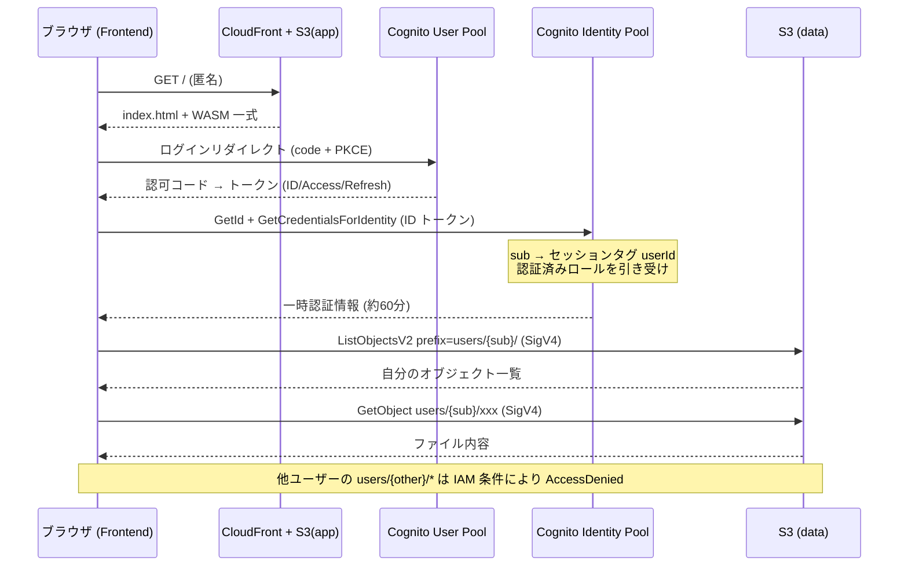

# 設計

## 前提と割り切り

| 項目 | 方針 |
|---|---|
| データの書き込み | **参照のみ**。S3 へのデータ配置は別システムが行う前提（検証用のシードスクリプトのみ同梱） |
| ユーザー登録 | セルフサインアップ無効。**管理者発行のみ** |
| UI | テンプレートとしての最小限。業務機能は含まない |
| リージョン | `ap-northeast-1` 固定（変更は `Template.IaC/EnvironmentConfig.cs` と `scripts/common.ps1`） |

## この構成が向かない条件

ユーザーごとの小〜中規模ファイルを本人だけが読む、という前提で成立している。次に当たる場合は API 層へ処理を寄せる設計に変える。

- 1 ユーザーあたりのデータ量がブラウザに載せられない規模になる
- 複数ユーザーを横断した集計・検索が必要になる
- データの結合・加工をサーバー側で行う必要がある

## 🏗️ アーキテクチャ

```mermaid
graph LR
    subgraph Browser["ブラウザ (Blazor WASM)"]
        App[Frontend]
    end

    subgraph AWS
        CF[CloudFront<br/>OAC + セキュリティヘッダー<br/>SPA フォールバック]
        AppBucket[(S3: アプリバケット<br/>非公開)]
        UP[Cognito User Pool<br/>Managed Login<br/>認証: OIDC code+PKCE]
        IP[Cognito Identity Pool<br/>認可: 一時 AWS 認証情報<br/>+ Principal Tag]
        DataBucket[(S3: データバケット<br/>users/&#123;sub&#125;/...<br/>非公開 + CORS)]
        APIGW[API Gateway HTTP API<br/>Cognito JWT オーソライザー]
        Fn[Lambda<br/>検証済みクレームを参照]
    end

    App -- "① アプリ配信 (匿名)" --> CF
    CF --> AppBucket
    App -- "② ログイン (リダイレクト)" --> UP
    App -- "③ ID トークン → 一時認証情報" --> IP
    App -- "④ SigV4 署名付き GET/List<br/>(本人プレフィックスのみ IAM 許可)" --> DataBucket
    App -- "⑤ /api/* + アクセストークン (Bearer)" --> CF
    CF -- "同一オリジンのまま転送" --> APIGW
    APIGW -- "検証済みクレーム付きイベント" --> Fn
```



④ と ⑤ は**認可の方式が異なる 2 本のレーン**。どちらも同じ Cognito サインインから出発するが、権限を評価する主体が違う（S3 は IAM ポリシー、API は API Gateway による JWT 検証）。

### AWS リソース

| リソース | 用途 | 要点 |
|---|---|---|
| S3 アプリバケット | Blazor publish 出力の配信元 | パブリックアクセス全ブロック。CloudFront OAC からのみ読み取り可 |
| CloudFront | アプリ配信 | OAC / HTTPS 強制 / 403・404 → `/index.html` (200) の SPA フォールバック / セキュリティヘッダー付与 / PriceClass 200 |
| S3 データバケット | ユーザー毎データ | パブリックアクセス全ブロック。CORS はアプリオリジンのみ。アクセスは SigV4 署名付きの直接リクエスト |
| Cognito User Pool | 認証 | Managed Login、code + PKCE、シークレットなし、セルフサインアップ無効 |
| Cognito Identity Pool | 認可（AWS 認証情報の払い出し） | 認証済みのみ。Principal Tag で `sub` をセッションタグへマッピング |
| IAM ロール（認証済み） | S3 データアクセス | `users/${aws:PrincipalTag/userId}/*` に限定 |
| API Gateway (HTTP API) | 認証付き API の入口 | JWT オーソライザーを全ルートに適用。CloudFront の `/api/*` ビヘイビア経由で同一オリジンとして呼ばれる |
| Lambda × 2 | API の処理本体（ダミー） | マネージド `dotnet10` ランタイム |

### 主要な設計判断

1. **データ参照に API サーバーを挟まない** — 「読み取り専用 + クライアント内処理」で成立する規模を前提とし、認可のみ IAM に委ねる
2. **データバケットは CloudFront を経由させない** — ユーザー毎の認可は SigV4 署名（= IAM 評価）で行う。CloudFront 経由で per-user 制御をするには Lambda@Edge での JWT 検証が要り、複雑さに見合わない
3. **アプリバケットとデータバケットを分離** — 公開ポリシー・CORS・キャッシュ・ライフサイクルの要件が異なる。単一バケット + プレフィックス分けは事故りやすい
4. **アプリ本体（WASM バンドル）は秘匿しない** — 配信自体は匿名で可能（一般的な SPA と同じ）。守る対象はデータのみ
5. **IaC は AWS CDK (C#)** — リポジトリを C# で統一でき、型付きで設定漏れに強い。Terraform でも実現可能だが .NET テンプレートとしての一体感が下がる
6. **API のルーティングは CDK 側に置く** — Lambda Annotations の `[HttpApi]` や SAM を使うとインフラ記述が 2 箇所に割れる

## 🔐 認証と認可

### 認証（Cognito User Pool）

- **フロー**: Authorization Code + PKCE。パブリッククライアント（シークレットなし）
- **UI**: Cognito Managed Login へリダイレクト。独自ログイン画面は作らない
- **Authority**: `https://cognito-idp.{region}.amazonaws.com/{userPoolId}`（OIDC ディスカバリー対応）
- **コールバック**: `authentication/login-callback`（`RemoteAuthenticatorView` の既定パス）
- **トークン有効期限**: ID / アクセス 60 分、リフレッシュ 30 日（Cognito 既定）
- **ログアウト**: 自前実装（理由は[実装上の落とし穴](notes.md#%EF%B8%8F-実装上の落とし穴)）

### S3 の認可（Identity Pool + IAM）

**Principal Tag（属性ベースアクセス制御）を採用**している。

| 方式 | 判定 |
|---|---|
| **Principal Tag** — ID トークンの `sub` をセッションタグ `userId` にマッピングし、IAM で `${aws:PrincipalTag/userId}` を使う | **採用**。S3 のキーを User Pool の sub で切れるため、データを配置する側が sub だけ知っていればよい |
| IdentityId 変数 — `${cognito-identity.amazonaws.com:sub}` でプレフィックスを切る古典パターン | 不採用。IdentityId は初回ログインまで確定せず、Identity Pool を作り直すと変わる。データ配置側との突合ができない |

- Identity Pool は認証済み ID のみ許可（ゲストアクセス無効）
- 認証済みロールの信頼ポリシーには `sts:AssumeRoleWithWebIdentity` に加えて **`sts:TagSession`** が必要（セッションタグ伝播の前提条件）

**データレイアウト**

```
s3://{data-bucket}/
  users/
    {userPoolSub}/          ← User Pool の sub (UUID)
      profile.json
      reports/2026-07.csv
```

**認証済みロールの IAM ポリシー**

```json
{
  "Version": "2012-10-17",
  "Statement": [
    {
      "Sid": "ListOwnPrefix",
      "Effect": "Allow",
      "Action": "s3:ListBucket",
      "Resource": "arn:aws:s3:::{data-bucket}",
      "Condition": {
        "StringLike": { "s3:prefix": ["users/${aws:PrincipalTag/userId}/*"] }
      }
    },
    {
      "Sid": "GetOwnObjects",
      "Effect": "Allow",
      "Action": "s3:GetObject",
      "Resource": "arn:aws:s3:::{data-bucket}/users/${aws:PrincipalTag/userId}/*"
    }
  ]
}
```

### API の認可（API Gateway JWT オーソライザー）

S3 と異なり、API は**トークンベース**で認可する。`Authorization: Bearer {アクセストークン}` を送り、API Gateway が署名・発行者・オーディエンスを検証する。

アプリは API を直接ではなく **CloudFront の `/api/*` 経由**で呼ぶ。同一オリジンになるため CORS プリフライトが発生せず、CSP も `'self'` で賄える。CloudFront 側はキャッシュ無効・`Authorization` ヘッダー転送の設定になっている（Host ヘッダーだけは転送しない。API Gateway が自身のドメインを見てルーティングするため）。

- **オーソライザーは全ルートに適用**する。ルート単位で付け忘れる余地をなくすため
- **Lambda 側に認可ロジックを置かない**。届いた時点で検証済み、という前提が重要で、二重に判定を書くと前提が曖昧になる
- Lambda はイベントの `RequestContext.Authorizer.Jwt.Claims` からクレームを読む。**クライアント申告値ではない**ため、`sub` で処理をユーザー単位に絞れる

**Lambda 直接 Invoke を採らない理由**: Identity Pool の一時認証情報で Lambda を直接呼ぶ案（S3 と同じ IAM 認可）はインフラ追加が最小だが、**Lambda 側で呼び出し元ユーザーを検証できない**（ペイロードの sub はクライアント申告値）。per-user なサーバー処理へ発展させられない。

**トークン種別の注意**: API Gateway はオーディエンスを `aud` **または** `client_id` で照合するため、**ID トークンを送っても検証は通る**（実測確認済み）。種別で拒否したい場合は Lambda 側で `token_use` クレームを確認する。

### シーケンス



## ⚡ パフォーマンス設計

初回表示は「ダウンロード → ランタイムブート → 認証状態の解決」の 3 つの待ちで構成される。

> 📌 計測の注意: ネットワーク計測（リソース取得の完了時刻）だけでは後半 2 つの CPU 実行が見えない。実際、当初はネットワーク完了後もページ表示まで通信ゼロの CPU 実行が続いており、そこが体感の支配要因だった。表示フェーズの遷移は DOM のサンプリングで測ること。また非表示タブはブラウザにスロットリングされ、絶対値が大きく出る。

### キャッシュ（2 段構え）

| 対象 | Cache-Control | 理由 |
|---|---|---|
| `_framework/` のフィンガープリント付きアセット | `public, max-age=31536000, immutable` | 内容が変わればファイル名が変わるため、古い実体が新しいマニフェストと組み合わさることが原理的に起きない |
| エントリーポイント（`index.html` / `dotnet.js` / `blazor.webassembly.js` / `appsettings*.json` / `css`） | `no-cache` | 上のファイル名を解決する側。ここが常に最新であることが整合性を担保する |

全ファイルを `no-cache` にすると、アクセスのたびに約 70 ファイル分の条件付き GET が発生し再訪が目に見えて遅くなる。**実測では 71 リクエスト → 8 リクエストに減った。**

### 適用済みの施策

| 施策 | 効果 |
|---|---|
| **AOT コンパイル**（`RunAOTCompilation=true`、publish のみ） | 起動時の C# 実行をネイティブ wasm 化。ペイポードは増える（転送ベース 2.5MB → 5.4MB）が immutable キャッシュにより初回限り。ローカルの `dotnet build` には影響しない |
| **アプリが使用可能になるまでスプラッシュ維持** | index.html と同一のスプラッシュを全画面で描画し、静的スプラッシュ → Blazor 描画 → 最初のページ が 1 つの連続した読み込みに見えるようにする |
| **`preconnect`**（cognito-idp / cognito-identity） | ランタイム取得中に DNS + TCP + TLS を済ませる。実測で認証時の接続確立コストが 0 になった |
| **IdentityId のセッションキャッシュ** | ページ読み込みごとの `GetId` が消え、Cognito Identity への呼び出しが 2 回 → 1 回 |
| **`AmazonS3Client` の再利用** | 呼び出しごとのクライアント構築（エンドポイント解決・署名器の初期化）をやめた |

### デプロイ時の処理

- **publish 前に出力ディレクトリを削除する**。`dotnet publish -o` は出力先を掃除しないため、過去ビルドのフィンガープリント付きアセットが溜まり続ける（実際に S3 のオブジェクトが 300 個まで増えた）
- **`.br` / `.gz` はアップロードしない**。S3 オリジンではコンテンツネゴシエーションが行われず要求されない（実測でリクエスト 0 件）
- **10MB 超のアセットは Brotli 圧縮済みボディを同じキーに配置する**（`Content-Encoding: br`）。CloudFront の動的圧縮は 10MB までのため、AOT 化した `dotnet.native.wasm`（約 19MB）が非圧縮で配信されてしまう。**実測 19MB → 3.98MB**
- `.wasm` / `.js` の Content-Type を明示設定する（環境により `application/octet-stream` と判定され圧縮対象から外れる）

### 見送った施策

- **OIDC ディスカバリーの省略** — API 上できない。`OidcProviderOptions.AdditionalProviderParameters` は `string` 値しか受け付けず、メタデータ文書をインラインで渡せない
- **初回ペイロードの削減** — AWS SDK が大きな割合を占めるが（`AWSSDK.Core` 584KB + `AWSSDK.S3` 199KB + `System.Private.Xml` 371KB、圧縮前）、SigV4 の自前実装や遅延ロードは実装量と保守コストに見合わない

## 🛡️ セキュリティ

| 項目 | 方針 |
|---|---|
| トークン保管 | Blazor WASM Authentication 既定（sessionStorage）。XSS 対策として CSP を必須とし、外部スクリプトを読み込まない |
| CSP | `default-src 'self'` を基本に、`connect-src` を Cognito と S3 に限定（API は同一オリジンなので `'self'` で足りる）。`script-src` は `'self' 'wasm-unsafe-eval'`（外部・インラインとも不可）、`frame-ancestors 'none'`。S3 のみリージョン内ワイルドカード（理由は下記） |
| S3（両バケット） | パブリックアクセス全ブロック + `aws:SecureTransport` 強制 + SSE-S3 |
| CORS | データバケットのみ。オリジンを CloudFront ドメイン（+ dev は localhost）に限定 |
| IAM | 認証済みロールは 2 ステートメントのみ。ワイルドカード禁止。Identity Pool のゲストアクセス無効 |
| Cognito | セルフサインアップ無効・管理者発行 |
| API | オーソライザーを API 既定に設定し、認可なしルートを作れないようにする。アクセストークンは `AuthorizationMessageHandler` の `authorizedUrls` により **API エンドポイント宛にのみ**付与され、S3 や Cognito へは送られない |
| 秘密情報 | アプリ・リポジトリに秘密情報を置かない |

### CSP のワイルドカードについて（意図的な選択）

`connect-src` のうち S3 だけが `https://*.s3.{region}.amazonaws.com` というリージョン内ワイルドカードになっている。具体的なホスト名に絞ることは**技術的には可能だが採用していない**。

**API は対応済み**で、CloudFront 配下に置くことで `'self'` に含まれるようになった（同時に CORS プリフライトも不要になった）。

**S3 を絞れない理由**: バケット名はデプロイ後に確定し、CloudFront から参照すると循環依存になる（バケットの CORS 設定が、この CloudFront のドメインを必要とするため）。絞るには次のいずれかが要る。

| 手段 | 副作用 |
|---|---|
| バケット名を固定する | S3 の名前はグローバルに一意。同じスタック ID を別リージョンへ展開すると衝突する |
| 2 回デプロイする | 「一連のコマンドで完了する」というテンプレートの前提が崩れる |

**ワイルドカードで許容できる理由**: この指定でも「同一リージョンの S3 以外のあらゆるホスト」は遮断されている。そして `connect-src` はあくまで多層防御の一枚であり、**スクリプトの実行自体を止めているのは `script-src`** で、こちらは外部スクリプトもインラインも一切許可していない。攻撃者がスクリプトを実行できて初めて `connect-src` の差が問題になるが、その前段が塞がれている。設定変更のたびに書き換えが必要になる維持コストに見合わないと判断した。

> ⚠️ **SPA フォールバックの副作用**: 403 → `index.html` (200) 変換により、アプリバケットに対する実際のアクセス拒否もアプリ画面として返る。仕様として許容している。
